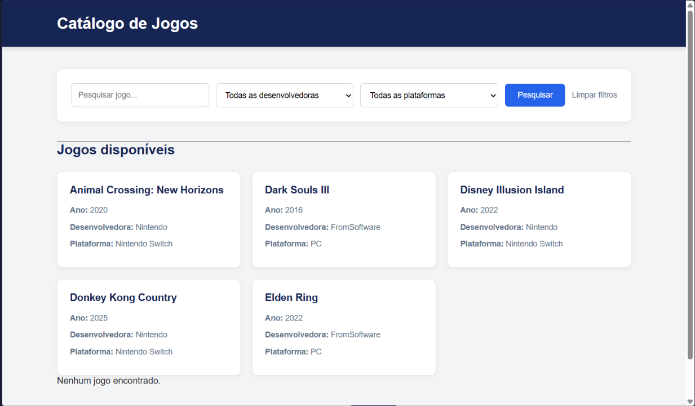
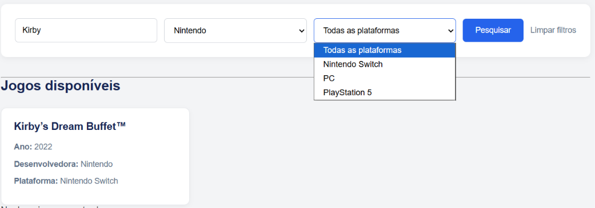
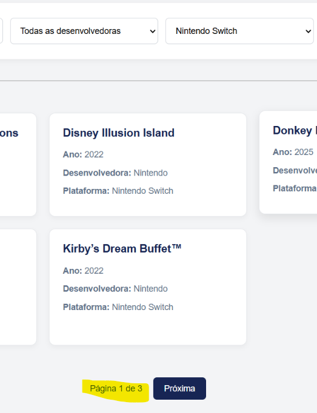

# 🎮 Catálogo de Jogos

## 1. Integrantes

- Valentina Marques
- Isabela Maia

## 2. Tema escolhido

**Catálogo de Jogos**

O projeto consiste no desenvolvimento de uma aplicação web para consulta de jogos, utilizando Python e Django. A aplicação permite visualizar os jogos cadastrados, realizar pesquisas por nome, aplicar filtros e navegar pelos resultados através de paginação.

## 3. Tecnologias utilizadas

- Python
- Django
- SQLite
- HTML5
- CSS3

## 4. Funcionalidades implementadas

### Listagem de jogos

Apresenta os jogos cadastrados no banco de dados, exibindo nome, ano de lançamento, desenvolvedora e plataforma.

### Pesquisa textual

Permite localizar jogos pelo nome, utilizando o método `icontains` do ORM do Django, possibilitando pesquisas sem diferenciar letras maiúsculas e minúsculas.

### Filtros dinâmicos

Foram implementados dois filtros utilizando campos de seleção (`select`):

- **Desenvolvedora:** permite filtrar os jogos de acordo com sua desenvolvedora.
- **Plataforma:** permite filtrar os jogos de acordo com a plataforma disponível.

Os filtros utilizam o método GET e podem ser utilizados individualmente ou combinados entre si e com a pesquisa textual.

### Paginação

A aplicação utiliza a classe `Paginator` do Django para organizar os resultados em páginas de cinco registros.

A navegação permite acessar as páginas anterior e seguinte, além de apresentar a página atual e o total de páginas.

### Preservação dos filtros

Os parâmetros da pesquisa textual e dos filtros selecionados são preservados durante a navegação entre as páginas.

## 5. Como executar o projeto

### 1. Clone o repositório

```bash
git clone URL_DO_REPOSITORIO
```

### 2. Acesse a pasta do projeto

```bash
cd atvjogos
```

### 3. Crie um ambiente virtual

```bash
python -m venv venv
```

### 4. Ative o ambiente virtual

No Windows:

```bash
venv\Scripts\activate
```

### 5. Instale as dependências

```bash
pip install -r requirements.txt
```

### 6. Execute as migrações

```bash
python manage.py migrate
```

### 7. Carregue os dados iniciais

```bash
python manage.py loaddata dados
```

### 8. Inicie o servidor

```bash
python manage.py runserver
```

Após iniciar o servidor, acesse a aplicação pelo navegador no endereço:

`http://127.0.0.1:8000/`

## 6. Capturas de tela

### Listagem dos jogos



### Pesquisa e filtros



### Paginação


